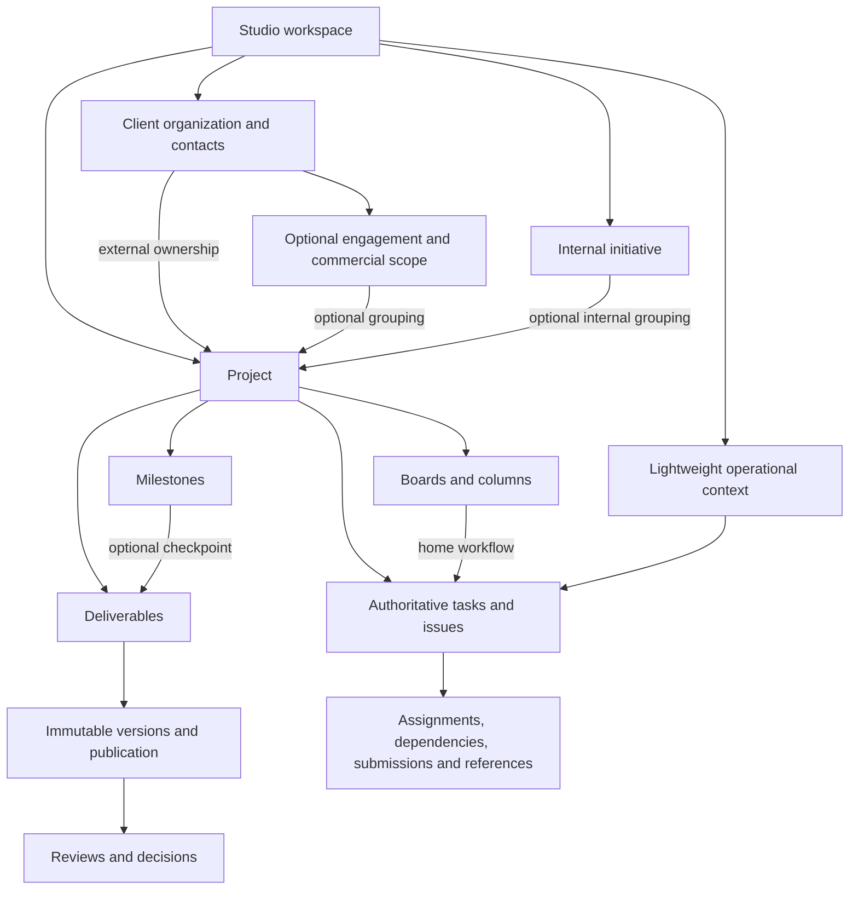

# Ordo architecture and implementation plan

Updated: 4 November 2026. Status: Phase 1 approved and implemented in isolated local development; the Phase 2 production-workspace plan is proposed for approval. Later phases remain the implementation roadmap. See `phase-1-verification.md` for completed scope, acceptance evidence and release limits.

**Revised strategy:** The user has confirmed that current application records are disposable. Build a clean canonical schema in an isolated development environment; no import, legacy backfill, old/new dual writes or database compatibility layer is required. Preserve useful code, components, design and working behavior. Production reset/deletion requires separate explicit confirmation identifying the target and scope. The conversation approval covers the isolated Phase 1 development work. It does not authorize production reset, cutover or deployment.

This plan covers all 18 sections of the complete brief, including Devine Apartments, Lora, recurring Inspirare Content, unified tasks, configurable boards, a single-owner client journey and strict security. It also preserves the requirement for clients to return to all authorized published work and Figma/Drive references after project completion.

## 1. Current architecture audit

The detailed evidence and verification baseline are in `current-architecture-audit.md`.

Retain React/TypeScript, existing design components, Supabase Auth integration, tenancy and scoped-invitation behavior, account cache clearing, project/task interactions, multi-assignee functionality, labels, comments, task drawers, deadline filters, transaction/concurrency patterns and useful email-delivery code. Existing database rows, IDs, memberships and ledger contents do not need importing. Adapt hooks and server commands directly to the canonical schema.

Extend the existing application incrementally. The current model lacks independent ownership/discipline/lifecycle dimensions, client businesses, initiatives/engagements, configurable boards, operational task scope, immutable publication packages and product planning records. Current column IDs and task statuses are coupled throughout UI, ordering, bulk actions and SQL.

Required unfinished experiences include the client work library, Messages, account settings, material intake and meaningful milestone management. Workspace search is currently inert. Preserve working behavior while replacing these incomplete paths.

Baseline: 89 frontend tests pass; TypeScript and build pass; four isolated SQL suites pass. Lint fails with 45 errors and 27 warnings. These checks are local and do not establish production readiness.

## 2. Proposed domain model and relationships

### Independent work dimensions

| Dimension | Proposed representation | Rule |
|---|---|---|
| Ownership | Client-owned engagement work or studio-owned work | Internal work has no required client, commercial agreement or portal. |
| Discipline | Multiple project discipline associations | Branding, web, software, content, growth and operations can coexist. Discipline does not determine ownership or lifecycle. |
| Lifecycle | Fixed scope, recurring, continuous development or ongoing operations | Independently selected; capabilities and templates support the chosen work. |

Use `organizations` as the canonical studio tenant root, with organization memberships and scoped grants. Existing interfaces may continue to call the studio space a workspace. Every business record carries or securely derives its organization scope. Define the final schema on its own merits; existing table names and historical schema defects impose no compatibility obligations.

At the schema level, project and operational branches each own a work-context record; boards/tasks reference that shared parent. The diagram shows business relationships rather than duplicating task stores.

A client organization and an internal initiative may each contain multiple projects. External projects link to a client business; engagements add agreed scope, timelines, revision allowances, payment milestones, financial references and change requests where applicable. Internal projects belong directly to the studio and may be grouped under an initiative such as Lora or Velmont.

Overall project stages are configurable independently of task columns. Lead/discovery can exist before a production project. Templates supply useful stage sequences; they do not force every project through client review, invoices or final closure.

### One task model, including operations

Define one canonical `tasks` record for a task, issue or feature, with priority, completion criteria, dependencies, references and optional product associations. Retain the existing UI behaviors and useful implementation patterns; no historical task rows or IDs need transferring. Once the new system is in use, a task retains its ID and connected history through workflow changes.

A task belongs to exactly one `work_contexts` parent within one organization. That context represents either a project or a lightweight operational context. Project and operational records attach to their context; boards and tasks use the same context reference. Context kind is immutable, and database constraints plus atomic creation commands enforce the correct parent. Tenant/context-aware foreign keys prevent tasks, boards, columns and related records from crossing scope. Operational contexts group recurring/admin work without requiring a project or fake client.

Project tasks have one home board and column. Operational tasks can be unboarded with a canonical status or use an operational board. Both appear in the same task workspace. Search, filters and reporting query the same task records.

### Reviews, inputs and retained work

Internal task submissions support discipline-specific previews and internal feedback. Client deliverable versions contain explicit manifests of the assets being shared. Promoting internal work into a client review requires an authorized publication action.

Client material requests have Requested, Submitted, Under Review, Accepted and Changes Required states, with submission history, responsible contacts, due dates and accepted assets.

Client-facing discussions use explicitly shared project threads. Internal discussions and client conversations have separate authorization and audiences. The Messages screen aggregates permitted threads.

Client access grants can cover all published work for a client owner or selected projects for other contacts. Completion and archiving preserve published library entries. Store named Figma/Drive/site references, review context and retained final exports. Preserve historical approvals when contacts later lose access.

### Optional connected capabilities

Add sprints, releases, QA runs and release notes as records linked to existing tasks/issues, projects and versions. Roadmaps display task-backed feature work and release/milestone targets. Backlog is a filtered collection of the same work items. Recurrence rules generate distinct work occurrences with a unique occurrence key; recurrence does not copy an existing task into several live views.

## 3. Board, column and task architecture

### Records and workflow authority

- **Board:** tenant, project or operational scope, name, order, template origin, archive state and access configuration.
- **Column:** board ID, stable ID, editable title, order and canonical status category.
- **Task:** one ID, context, one home board/column when boarded, order within the column, assignees and work metadata.
- **Board template:** a versioned configuration snapshot of columns, mappings and defaults. Applying/duplicating it creates independent configuration IDs and does not duplicate tasks by default.
- **Saved view:** view type, filters, grouping and sorting over authorized task IDs. Saved filters cannot broaden permissions.

Define stable backlog/to-do/in-progress/review/done reporting categories as product semantics. Their agreement with current task behavior is useful, but they are independent of historical database constraints. Column names are freely editable. For example, Testing can map to review and Published to done. Renaming a column does not rename its category or break reporting. A backend transaction maintains agreement between a task's home column and canonical status.

**Proposed membership rule:** a task has one authoritative home workflow. Board, list, calendar, timeline, roadmap and dashboard views can all show it by reference. Moving it to another board changes its home board/column atomically; its ID and history remain intact. Any later feature allowing secondary-board appearances must identify the home workflow and cannot introduce competing statuses or duplicate task rows.

### Required actions and safe behavior

| Action | Rule |
|---|---|
| Create/rename/reorder board | Persist authorized configuration and audit the change. |
| Duplicate configuration | Copy columns/mappings/defaults into a new board; copying tasks is a separate explicit operation. |
| Archive/restore board | Preserve columns, task IDs and history. Open tasks remain discoverable in unified tasks; archived board state is visible. Archiving is not task completion. |
| Remove populated column | Require a valid destination column or an explicit authorized task-archival operation. Preserve task records and history. |
| Delete populated board | Require an authorized reassignment plan; offer archive as the recoverable action. Reassign tasks and delete configuration in one transaction. |
| Delete empty board | Allow after confirmation and dependency checks. No cascade from board/column deletion to task deletion. |
| Move/reorder task | Validate source/destination tenant, project/context and permissions; check concurrent versions; commit column/category/order together. |
| Restrict board | Narrow project access, never expand it. Enforce equivalent restrictions through task queries, dashboards, search, references and storage. |
| Save template | Save configuration and its mappings; exclude private project data and task content. Tenant scope templates by default. |

Adapt the existing ordering RPC, drag/drop implementation, shortcuts and bulk menus. Ordering becomes board/column scoped rather than grouping all project tasks by fixed status.

### Multiple views

All views consume shared authorized task queries and mutation commands. A date change in Calendar, a move in Board or an edit in List changes the same record. Filters/grouping/sorting are view configuration.

Implement incrementally based on existing code and project priorities. Start with the working board and task list foundation. Calendar follows deadline work; Timeline requires dependable date/dependency semantics; Roadmap appears only when product planning is enabled and usable. Do not expose view tabs that lead to placeholders.

## 4. Roles and permissions matrix

Job discipline and authority are independent. Designer, writer and developer do not require three permission engines. Define canonical organization memberships and scoped capabilities such as manage-board, internal-review, publish-client-work, manage-commercial-scope and approve-client-version. Reuse tested authorization intentions while replacing obsolete schema helpers and grants.

Every permission below is limited by active membership, tenant, assigned project/context, board restrictions and publication state. Administrators receive studio-wide scope. A project manager's authority does not grant them client sign-off.

| Person | Work visibility | Task work | Configure boards | Clear internal review | Publish to client | Client feedback/approval | Commercials/access |
|---|---|---|---|---|---|---|---|
| Studio owner/admin | Studio-wide | Manage | Manage | Yes | Yes | No automatic client sign-off | Manage |
| Project manager | Managed projects/contexts | Manage | Manage | When granted | Yes | Coordinate; cannot impersonate approver | Assigned scope; limited project invitations |
| Creative lead | Assigned projects | Contribute | When granted | Yes | When granted | Read authorized published feedback | No default access |
| Designer/motion designer/writer | Assigned work/projects | Contribute | When granted | Submit own work | No default grant | Read relevant shared feedback | No |
| Developer/QA contributor | Assigned work/projects and enabled capabilities | Contribute | When granted | As assigned | No default grant | Read relevant shared feedback | No |
| Restricted collaborator | Explicitly assigned scope | Granted actions | No default grant | Submit own work | No | Relevant feedback only | No |
| Client reviewer | Authorized published projects/library | Submit requested materials | No | No | No | Comment and request clarification | Shared commercial records only |
| Client approver/owner | Granted library or selected projects | Submit requested materials | No | No | No | Decide on explicitly assigned published versions | Shared commercial records only |

One client owner can hold reviewer and approver capabilities. One studio person can hold PM and creative lead capabilities. Preserve historical actor IDs when roles change.

Enforce rules in commands, table grants/RLS and private storage policies. Deny anonymous privileged RPCs; re-check current membership rather than trusting stale frontend state. Client-visible projections must exclude sensitive columns as well as rows. Design file access around asset authorization rather than treating a project-folder prefix as sufficient permission.

## 5. Internal and client journeys

### External engagement: Devine Apartments

Create the client business and contacts; agree branding and website scope; create a client project; select disciplines, lifecycle and a template; configure boards/milestones and assign the team. Request client materials and track review/acceptance. Produce drafts, run internal reviews and publish exact deliverable versions. Collect client feedback/approval, manage scope changes/payment milestones, publish the handover and complete the project. Client returns through normal sign-in to find published history and final assets.

### Internal product: Lora

Choose Internal Studio Project; attach it to the Lora initiative; select software/design/growth disciplines and continuous development. Configure separate Design, Development and Marketing boards using custom columns. Enable roadmap/issues/sprints/releases/QA only where useful. Move the same task between workflows when appropriate, link work to release targets, record testing and publish release notes. No client, invoice or external approval is required.

### Recurring studio work: Inspirare Content

Create a lightweight operational context and recurring assignments; optionally use a campaign project when it provides real value. Assign writers/designers/motion creatives, track production and internal approval, record publishing dates and outcomes. Due occurrences appear in unified tasks alongside client and product work. Every generated occurrence is independently tracked and can be skipped, revised or rescheduled.

### Creative/developer

Sign in → My tasks → filter by dates, project/context and priority → open a task → read brief/references/dependencies/completion criteria → produce work → submit a version for internal review → resolve feedback → complete the assignment. Authorized changes persist and appear in other task views.

### Small client owner

Accept invitation → enter the prepared project → submit requested materials → see submission status and requested corrections → open the exact published website/design version → comment or approve → receive handover → return later to the project library. One person handles review and approval with minimal setup.

### Board administrator

Create a blank/template board → configure columns and category mappings → assign access → add/move tasks → reorder/rename configuration → save/duplicate a template → archive/restore → safely reassign tasks before deletion. Verify each action after reload.

### Project setup

Begin with Client Project or Internal Studio Project. Then offer Blank or Template, followed by only relevant fields. Client setup selects the business and optional engagement; internal setup selects an optional initiative. Introduce boards, milestones, team and optional capabilities progressively. Creating the project and essential membership/configuration must be transactional.

## 6. Clean schema and environment strategy

These are proposals, not executable migrations. Start a new canonical baseline for isolated development. Retire the obsolete migration chain from that new bootstrap path while retaining its source history/reference value. Do not rewrite a hosted migration ledger or apply the baseline to an existing production project.

### Environment boundaries

- Local/development: use a dedicated target with its own database, Auth configuration, credentials and private storage. Build/reset it with deterministic synthetic fixtures after Phase 1 approval. No production database dumps, client files or real-recipient mail are required.
- Staging: use a separate nonproduction target for realistic Supabase Auth, Storage, gateway and worker checks, with controlled recipients. It can be freshly initialized from the canonical migration chain.
- Production: keep its records, Auth users, storage objects, secrets and migration ledger untouched during development. Disposable-record permission does not authorize a production reset, cutover or deletion.
- Reset tooling must verify an explicit development target allowlist using project reference/host and reject production or unknown targets. A frontend mode or a loosely named environment variable is not sufficient proof.
- Application schema scripts must not drop Supabase-managed Auth/Storage schemas or delete user accounts/object bytes implicitly. Development test identities and any object cleanup have separate, scoped seed/cleanup procedures. Production operations need explicit confirmation of the exact target and scope.

### Schema delivery batches

| Batch | Canonical structures | Delivery rule | Verification |
|---|---|---|---|
| S1 — Foundation baseline | Organizations/memberships/grants, client businesses/contacts, initiatives, lightweight engagements, independent project dimensions, work contexts, foundational board/column/task relationships and private asset metadata | Create the intended relationships directly. Use one milestone completion representation and one authoritative task model. Keep commercial fields separately authorized. Adapt existing Auth/workspace and project setup/list data access to this schema. | Empty-database bootstrap, ownership/context constraints, valid client/internal setup, direct permission denial and private storage checks. |
| S2 — Board workflow | Board commands/access, column mappings/order, templates, saved configuration and atomic task movement | Implement complete board interactions over S1; add only genuinely needed columns/constraints. No legacy board/task import. | Configuration CRUD, safe deletion/reassignment, concurrency, task/history integrity after creation. |
| S3 — Unified production | Operational assignment commands, dependencies, references, priority, internal submissions and shared views | Operational context and task ownership are already modeled in S1; expose working capabilities in slices. | Unified tasks, no duplicate records across views, date/priority/project filters and cycle prevention. |
| S4 — Publication/reviews | Asset manifests, immutable versions, staged uploads, internal review, publication grants and exact-version decisions | Create clean review/approval structures without importing mutable legacy deliverables or past decisions. | Draft privacy, designated approvers, stale decisions, finalized uploads and cleanup recovery. |
| S5 — Client service/library | Material requests/submissions, shared threads/messages, updates, resource references, retained handovers and library access | Use one canonical milestone state and explicit publication/access. All content starts as new fixtures or new work. Later manual historical-content entry can be a product feature; it is not a migration requirement. | Returning client, small owner, completed-project history, scoped search and provider-link recovery. |
| S6 — Product/recurrence | Task-linked sprints/releases/QA/release notes, roadmap configuration, recurrence rules and occurrence keys | Opt in per project/context. No duplicate issue/feature task store. | Lora release journey and recurring-content idempotency. |
| Cross-cutting — Events/reliability | Audit events, transactional outbox, retry/dead-letter tracking, storage reconciliation and retention | Add support with the first command needing it. Reuse useful delivery code without importing old log rows or maintaining obsolete email functions. | Atomic event recording, duplicate/uncertain-send cases, file withdrawal/recovery and access revocation. |

Use composite foreign keys or equivalent validated parent checks for organization/context/board/column consistency. Use RESTRICT or controlled archival for board parents; normal configuration deletion cannot erase tasks. Future published client work and approvals retain the agreed archival/history guarantees. The current-record disposal clarification does not weaken those product guarantees.

Migrations remain versioned and repeatable after the clean baseline. At this development stage, resetting the verified development target and reseeding is a valid recovery path. Once real production work starts, use reviewed forward migrations and appropriate recovery procedures for that data. An eventual production cutover/reset is a separately reviewed operation with explicit confirmation.

## 7. Phased implementation roadmap

| Phase | Scope | Exit condition |
|---|---|---|
| 1 — Isolated clean foundation | Verify nonproduction isolation; establish canonical S1 and synthetic seed/reset tooling; adapt Auth/workspace and progressive client/internal project creation/list; document visible-action register and baseline defects | The usable sign-in → authorized studio → create client/internal project → find it again slice passes the Phase 1 criteria. No legacy data imported and production untouched. |
| 2 — Configurable boards and unified tasks | S2 plus the core production subset of S3: board/column configuration, templates/access/recovery, canonical task commands, drag/menu movement, Board/List, My Tasks/deadlines, priority/assignment and basic operational work | Phase 2 criteria pass: actual production work persists across views, task IDs/history survive board operations, and concurrency/permission boundaries hold. See phase-2-production-workspace.md. |
| 3 — Production extensions | Remaining S3: dependencies, internal submissions, task comments/labels/attachments and useful Calendar, connected to the canonical task infrastructure delivered in Phase 2 | Extended production journeys work without duplicate records; preserve Phase 2 unified task and deadline behavior. |
| 4 — Client delivery and lasting library | S4/S5 with event reliability; materials, exact-version reviews, messages, updates, final assets, return access, real account settings/search | Acceptance A and F pass; required client placeholders replaced; client privacy enforced. |
| 5 — Connected product and recurring work | S6; Lora roadmap/backlog/sprints/releases/testing; recurring content and publication tracking; Timeline/Roadmap as dependencies become usable | Acceptance B and C pass. Only completed views appear in navigation. |
| 6 — Full release qualification | Remaining durable operations, performance/accessibility, exhaustive action/role journeys and restore drills | All A–G scenarios pass, including production-like security checks and no visible Coming Soon/dead controls. |

Security, migrations, observability and verification ship with every phase. Phase 6 is final qualification, not the first security review. Phase ordering can overlap independent client/board work after dependencies are satisfied.

Phase 1 is complete locally; see [phase-1-verification.md](phase-1-verification.md). The user subsequently requested customizable boards and unified task management together in Phase 2. The detailed [Phase 2 proposal](phase-2-production-workspace.md) includes database changes, tasks, acceptance criteria and verification; implementation awaits its approval. Production reset or live deployment remains a separate decision.

### Functional-control release policy

Required workflows must work end to end. Each visible action needs permission enforcement, validation, persistent outcome where relevant, loading/error/success/empty states, and a useful next step. Confirm state after reload and account changes.

Implement real client Deliverables/library, Messages and account settings. Wire meaningful search and review details. Replace toast-only profile actions. Repair milestone management. Optional later features stay unexposed until complete; do not replace placeholders with links that fail elsewhere.

Preserve typography, spacing, components, premium visual language, responsive behavior and accessible keyboard/focus patterns. Reuse existing interactions and add purposeful motion with reduced-motion support.

## 8. Testing and verification strategy

| Required scenario | Evidence required before acceptance |
|---|---|
| A — Devine Apartments | Branding + website scope, materials through every intake state, production, internal clearance, versioned client review/revisions/approval, payment milestones/change requests and retained handover. |
| B — Lora | Internal setup, three differently configured boards, one authoritative task per issue/feature, roadmap/sprint/QA/release records and release notes without client requirements. |
| C — Inspirare Content | Recurring internal assignments, distinct occurrence tracking, internal reviews and recorded scheduled/published outcomes; safe reruns. |
| D — Unified Tasks | Assignments across external/internal/operational work, secondary assignees, priority/project filters, today/week/overdue/upcoming/custom dates, timezone and week boundaries; edits reflected across views. |
| E — Board customization | Create/rename/reorder/duplicate configuration, templates, archive/restore, remove populated columns safely, delete boards without losing task IDs/history, concurrency/undo recovery. |
| F — Small client | New and returning owner, correct project entry, material submission/corrections, mobile review, single-person approval, final downloads and past-work library. |
| G — Security | Two-studio and two-client allow/deny tests for every table/RPC/storage action; unpublished assets/internal discussions private; restricted-board data absent from other views/search/notifications; revocation and signed-URL lifetime behavior verified. |

Test at complementary layers:

1. Unit tests for category mappings, state transitions, date/priority filters, ordering, recurrence keys and dependency cycles.
2. Isolated SQL schema/RLS/transaction suites for organization/parent consistency, allowed and denied roles, duplicate/stale submissions, board movement and safe deletion. Verify an empty-database bootstrap, repeatable development reset/seeding and the current canonical migration chain. Port useful security assertions to the new schema rather than retaining old-schema fixtures as compatibility requirements.
3. Actual Supabase staging tests for auth gateway, Storage upload/download/revocation, service-role command checks and migration metadata. Local platform stubs do not establish these properties.
4. Frontend integration tests for required actions, correct destinations, error recovery, persistent state and account/workspace changes.
5. Browser journeys at desktop and mobile widths, keyboard-only review, focus/dialog behavior, zoom and reduced motion. Include physical mobile/Safari checks before certification.
6. Controlled-recipient email round trips, outbox retry/dead-letter scenarios, duplicate suppression and uncertain delivery reporting. SMTP acceptance and mailbox receipt are separate checks.
7. Database-plus-object recovery drills, preserved handover/version integrity and exports. Verify external Figma/Drive access with intended test recipients; links alone are not preservation.
8. CI runs type checks, lint, unit/integration and SQL checks; migrations are tested before frontend features depending on them are enabled.

Before each release, review the route/action register as the appropriate studio/client roles. Re-test errors and legitimate disabled states. No success claim is accepted when zero authorized rows changed, a job was lost, or a supposed result disappears after reload.

## Approval boundary

Phase 1 was approved and completed in isolated local development. Approval is now requested for the Phase 2 production-workspace proposal. This planning revision changes documentation only; no Phase 2 application or schema implementation has begun. Approval covers only the explicitly proposed development implementation and testing. It does not authorize a production reset/deployment, deletion of production Auth users/storage objects, or rewriting a production migration ledger.
