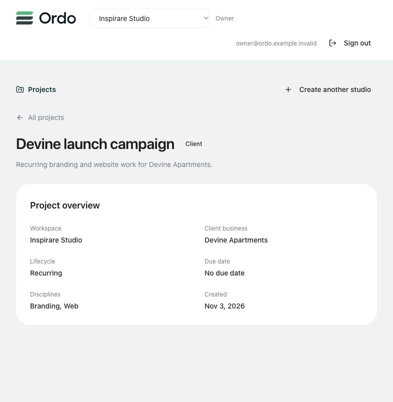
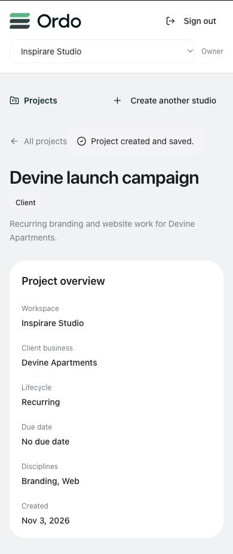

# Phase 1 verification — 3 November 2026

Status: implemented and verified in isolated local development. The approved outcome works inside the existing React application: **real sign-in → authorized studio → create client/internal project → reopen the saved overview**. This is the completed foundation phase, not completion of every feature in the architecture brief or permission to deploy/reset production.

## Implemented

- A separate canonical Supabase baseline with studio tenancy, role capabilities, independent client businesses/contacts, internal initiatives, optional private engagements, work contexts, projects, disciplines, boards/columns, authoritative tasks, milestones, private asset metadata, audit events and payload-bound command receipts.
- Composite tenant/context constraints, read policies and explicit transactional creation commands. Project/context/default-board/membership writes commit together. Organization/context membership revocation removes access even when the creator's Auth token remains valid.
- An isolated application mode reusing Ordo's Auth, branding, form controls, typography and surfaces. It supports real studio creation/selection, project search/ownership filters, progressive client/internal creation, optional initiatives, saved overviews and recoverable errors. All actions exposed in this slice have implementations. Legacy workspace hooks do not run against the new schema.
- Foundation client initialization accepts only explicit development mode and the dedicated loopback API. A server identity gate verifies development/local/schema version before mounting business queries. Auth storage and account/organization query keys are isolated.
- Guarded local native-runtime setup, checksum migration ledger, synthetic Auth-backed fixtures, app-record reset and idempotent reseeding. Production/unknown targets and conflicting reset arguments are rejected. Existing production configuration and migration history remain separate.
- A private Storage bucket with metadata/context authorization, tested with actual bytes and fresh signed URLs. Upload/publication interfaces are deliberately not exposed before their later phases.
- CI configuration at `.github/workflows/foundation.yml`: types, focused lint, all frontend tests, target safety, canonical SQL and both builds. Hosted CI execution remains to be observed after these local changes are pushed.

## Acceptance evidence

| Criterion | Result and evidence |
|---|---|
| P1.1 Target isolation | Passed: 17 safety tests; production protection is built into validation, not only editable configuration. Runtime and frontend check exact local endpoints; bootstrap/reset additionally require database identity. |
| P1.2 Reproducibility | Passed: canonical migration and rollback suites ran in two fresh isolated PostgreSQL instances. Real local bootstrap succeeded, local app records were reset, checksum bootstrap repeated, then seed repeated without duplicates: 2 studios, 3 projects, 3 boards, 1 contact and the same 6 Auth identities. Later integration/browser proofs intentionally add synthetic projects. |
| P1.3 Real authentication | Passed: actual local Auth sessions, organization resolution and effective capabilities; direct membership/user-metadata escalation denied. Browser sign-out/account changes showed a member only Lora and denied a client the internal workspace. Account-scoped query/cache tests pass. |
| P1.4 Correct setup | Passed: internal Lora without a client; Devine branding/web linked to a client business; a contact with no login. Browser-created internal continuous software/operations work, recurring client branding/web work and a new small-business project. |
| P1.5 Atomic persistence | Passed: SQL injected-failure rollback, real invalid-ownership rollback, concurrent identical retries and payload-mismatch rejection. Browser overview survived reload and a new sign-in through its protected deep link. |
| P1.6 Tenant/role boundaries | Passed: owner/admin/manager/member/scoped grants/two-client SQL matrix; real REST/RPC cross-studio, direct-write and client-denial checks. Revoking a project creator's membership removed project access. |
| P1.7 Private files | Passed: actual authorized object download and signed URL; other studio, two clients and anonymous denied. Public URL failed. A member could download/sign before membership deactivation and could do neither afterward, without token refresh. |
| P1.8 Core UI | Passed: browser sign-in, internal/client creation, saving a business without email/password, reload, fresh sign-in, scoped account switching, keyboard activation/tab order and a 390px mobile viewport with no horizontal overflow. Mocked frontend integration covers failure/retry, filters and studio switching. Screenshots below use synthetic records. |
| P1.9 Code quality | Passed for the agreed slice: 117 frontend tests across 19 files; 17 target/runtime-argument safety tests; four canonical SQL suites in each of two fresh instances; 9 real Auth/REST/Storage groups; app and Vite-config TypeScript; focused lint; standard and foundation builds. Repository-wide legacy defects remain explicitly listed below. |
| P1.10 Scope integrity | Passed: existing UI/components and working deadline code retained, no legacy row import/compatibility views/dual writes. No production reset, migration, account change, Storage change or deployment was performed. |

`verify:foundation:local` uses platform catalog stubs and does not by itself certify real Auth/Storage. `verify:foundation:runtime` supplies that separate transport verification. Runtime reports, synthetic account credentials and connection details remain ignored under `.foundation-runtime`; do not publish them.

## Run and verify

See `foundation-environments.md` for local setup and reset boundaries. Normal commands from the repository root:

```sh
npm run foundation:setup
npm run dev:foundation
```

Open `http://127.0.0.1:5182`. The local fixture sign-in details are in ignored `.foundation-runtime/accounts.json`.

```sh
npm run typecheck
npm run lint:foundation
npm test
npm run test:foundation:safety
npm run verify:foundation:local
npm run verify:foundation:runtime
npm run build
npm run build:foundation
```

The runtime integration suite is explicitly local and uses synthetic accounts. It adds idempotent proof projects and a private synthetic file, temporarily changes fixture memberships and restores them. Run it after seeding the dedicated local target. It is not a production verification command.

## Remaining release work

- Full board customization and templates, unified task integration against the canonical schema, operational task UI and later views are subsequent phases. Existing deadline behavior is retained and regression tested; its legacy hooks have not yet been connected to canonical tasks.
- Client publication, material requests, immutable review/approval, messages, notifications and permanent work-library interfaces are later phases. A client currently receives a safe restricted account screen in this development mode, not a completed client portal. Existing legacy Coming Soon surfaces are itemized in `current-architecture-audit.md`; they are not destinations in this new slice. Do not release the full architecture until required controls are implemented and verified.
- Signed URLs are bearer links until expiry. Revocation blocks fresh authorization and authenticated downloads; it does not invalidate an already-issued signed URL immediately. Figma/Drive sharing permissions and long-term external-link availability still need their own policy and tests in the library phase.
- Repository-wide lint currently reports **43 errors and 27 warnings**, reduced from the audited 45 errors by fixing two conditional shared Auth hooks. Focused foundation lint passes. Existing error counts: `ProjectBoard.tsx` 2; `ui/command.tsx` 1; `ui/textarea.tsx` 1; `useProjectFiles.tsx` 2; `useTaskAttachments.tsx` 2; `useTeam.tsx` 6; `workspaceScope.ts` 2; `ActivityPage.tsx` 1; `Settings.tsx` 2; shared Edge Function `app-url.ts` 1; transactional-email `registry.ts` 3; `tailwind.config.ts` 1; `tests/board-workspace.tsx` 15; `tests/invitation-journey.tsx` 4. Preserve concurrent uncommitted board work while resolving these before full release.
- The production-dependency audit reports **12 high and 2 moderate advisories, no critical advisories** in the existing dependency graph. High findings include router packages, PostCSS, Zod and transitive build/runtime packages. Triage exposure and update with regression checks before public release; no broad forced dependency upgrades were mixed into this schema phase. `pg` and the Supabase CLI were added as development tooling.
- Existing build warnings remain: large initial bundle, stale Browserslist data and ambiguous Tailwind duration utility. Native Supabase runtime is pinned development tooling; production deployment, provider configuration, reliable notification processing, backup/restore and environment cutover remain separate qualification work.

## Browser evidence

Desktop saved client project after a fresh sign-in:



Mobile saved project at a 390px viewport:


